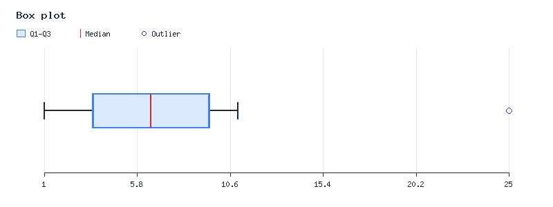

# BoxPlot

[Usage index](../README.md)

`ReeStyleIt\NumberClass\Statistical\BoxPlot` provides precomputed, readonly data for
a box-and-whisker plot. It extends readonly `Sample`. Use
`new BoxPlot(iterable $values)` or the namespaced `boxPlot($values)` helper.

```php
use function ReeStyleIt\NumberClass\boxPlot;

$plot = boxPlot([-100, 1, 2, 3, 4, 5, 6, 7, 100]);
$plot->median; // 4
$plot->q1; // 1.5
$plot->q3; // 6.5
$plot->iqr; // 5.0
$plot->lowerWhisker; // 1
$plot->upperWhisker; // 7
$plot->outliers; // [-100, 100]
$summary = $plot->get(); // readonly Statistical\BoxPlot\Result
$summary->median; // 4
$summary->outliers; // [-100, 100]
```

| Property | Meaning |
| --- | --- |
| `min` | Smallest observation, including outliers |
| `q1` | Median of the lower half |
| `median` | Median of the entire sample |
| `q3` | Median of the upper half |
| `max` | Largest observation, including outliers |
| `iqr` | `q3 - q1` |
| `lowerWhisker` | Smallest observation within the fences |
| `upperWhisker` | Largest observation within the fences |
| `outliers` | Sorted observations outside the fences, retaining duplicates |

All scalar summary properties are `int|float`. `get(): BoxPlot\Result` returns a
precomputed readonly `ReeStyleIt\NumberClass\Statistical\BoxPlot\Result`. It exposes the
properties in the table, including a readonly `outliers` array. Repeated calls return
the same result without recalculating. The properties also remain accessible directly
on `BoxPlot`.
The inherited `values` property exposes a sorted copy of all observations.

Quartiles use medians of the lower and upper halves, excluding the middle observation
for odd sample counts. A singleton uses its value for both quartiles, median, and both
whiskers. This is an explicit convention; other software may interpolate quartiles
differently. Fences are `q1 - 1.5 * iqr` and `q3 + 1.5 * iqr`; observations exactly on
a fence remain inliers. Whiskers end on actual observations. See the
[NIST box plot reference](https://www.itl.nist.gov/div898/handbook/eda/section3/boxplot.htm)
for the IQR outlier rule.

Inputs follow [Median](Median.md)'s finite numeric sample rules. Invalid samples or
nonfinite calculated fences throw [StatisticalException](../Exceptions/StatisticalException.md).

All `Base` value objects expose `boxPlot` and `boxPlot()` for stored numeric arrays.
See [statistical accessors](../Base.md#statistical-accessors).

## Image rendering (optional GD extension)

`image(int $width = 800, int $height = 300): GdImage` creates a fresh horizontal box plot
using the precomputed result. It draws the quartile box, median, whiskers, outlier
markers, a numeric axis, and a legend. It does not write files or send HTTP headers.
GD is optional: `ext-gd` appears only in Composer's `suggest` section. Calculation,
construction, shared accessors, and `get()` continue to work without it.

```php
use function ReeStyleIt\NumberClass\boxPlot;

$plot = boxPlot([1, 2, 3, 4, 5, 6, 7, 8, 9, 10, 11, 25]);
$image = $plot->image(width: 800, height: 300);
imagepng($image, 'box-plot.png'); // Requires GD with PNG support.
```



To serve it directly, send `Content-Type: image/png` before calling `imagepng($image)`.
The returned GD object can also be used with other GD encoders supported by the local
installation. Repeated calls return independent images and preserve the readonly
statistical result.

Image sizes range from 320 × 180 to 4096 × 4096 pixels. Invalid dimensions throw
`StatisticalException`. If GD or its image creation function is unavailable,
[BoxPlotImageException](../Exceptions/BoxPlotImageException.md) explains the requirement.
Allocation failures also use that runtime exception. Singleton and constant samples
are centered on a single axis tick. Repeated outliers at the same value overlap.
